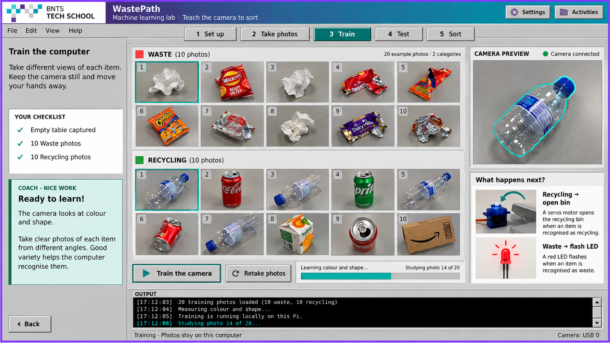

# WastePath training workspace render

This is an illustrative design mockup in the PiPath visual style, with example
Waste/Recycling photo sets, training progress, camera preview and servo/LED actions.
It is a design render, rather than a screenshot of the currently implemented app.

