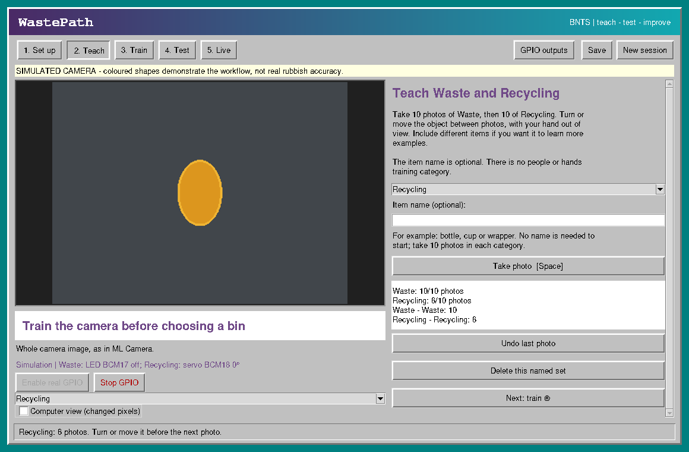
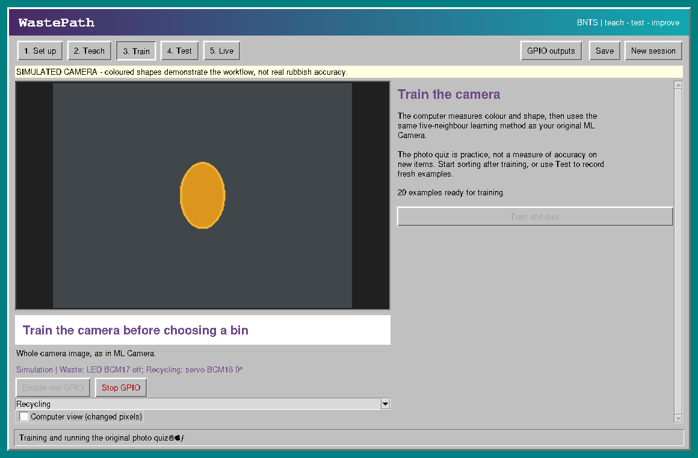

# Screenshots of the actual WastePath application

These images were captured directly from the unchanged, running Tk application.
The app was driven through setup, ten Waste captures, ten Recycling captures and
Train and quiz. Training completed successfully and the application opened Live.

The built-in camera simulator supplied the coloured shapes because this cloud
machine has no attached USB webcam. The on-screen simulator banner is retained.
No generative image model, edited controls, replacement UI, fabricated progress
bar or injected training delay was used to make these screenshots.

## Collecting examples

Actual Teach screen after ten Waste captures and six Recycling captures:

## Training

Actual Train screen immediately after pressing Train and quiz with twenty
captured examples. Computation on twenty examples is quick; this is the transient
busy UI state before the next camera/UI tick opens Live.

[View the screen before pressing Train](actual-app-training-ready.png).
[Capture evidence](actual-app-capture-evidence.json) records counts and completion.

The current app displays a camera preview and capture counts. It does not contain
the photo-thumbnail gallery depicted in the earlier illustrative design render.
These screenshots establish what the app looks like, not real webcam accuracy or
physical Raspberry Pi/GPIO behaviour.
